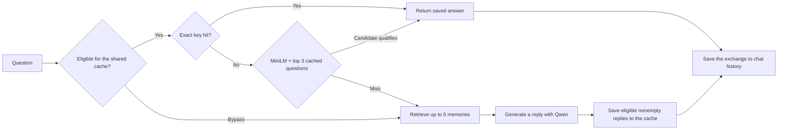

# 🧠 ScyllaDB AI Memory Lab

**A local Qwen chatbot with persistent conversation history, vector memory, and a semantic answer cache in ScyllaDB Cloud.**

The lab lets you ask a question, see whether Qwen generated the reply or ScyllaDB reused it, and inspect the matches that led to that decision. MiniLM generates 384-dimensional embeddings locally. ScyllaDB runs approximate nearest neighbor (ANN) search, and Ollama serves Qwen 3 8B on your machine.

[Quick start](#quick-start) · [Request flow](#request-flow) · [Reading the UI](#reading-the-ui) · [CQL and test scripts](#cql-and-test-scripts) · [Project map](#project-map)

## Request flow



| Path | What the code does |
| --- | --- |
| ⚡ **Exact cache** | Normalizes the question and hashes it with SHA-256. A primary-key hit returns the saved answer without embedding, ANN, or a Qwen call. |
| 🔎 **Semantic cache** | Embeds the question with MiniLM and queries the three closest cached questions. The first qualifying candidate supplies its saved answer. A candidate needs a cosine score of at least **0.85** and matching markers. |
| ✨ **Qwen generated** | On a cache miss, reuses the embedding to retrieve up to five saved memories. Qwen gets the question and those memories. A nonempty reply is cached for **one hour**. |
| 💬 **Qwen with chat context** | Follow-ups and other prompts that fail the standalone-question check bypass the answer cache. Qwen receives retrieved memories and up to 12 prior chat messages. |

The marker check covers selected details such as numbers, negation, and the NC/SC aliases used in the lab. High cosine similarity can still pair questions with different meanings. A saved answer can also be wrong or stale. The app has no live source lookup or fact verification.

### What ScyllaDB stores

| Table in `ai_memory_lab` | Contents |
| --- | --- |
| `chat_messages` | User prompts and assistant replies, ordered by time within each conversation UUID. Use the UUID in the sidebar to resume a chat. |
| `chat_memories` | Prompts beginning with `Remember ` and their embeddings. Retrieval searches across the lab. |
| `semantic_answer_cache` | A normalized question hash, the original question, its answer, and its embedding. Exact and semantic hits reuse the existing answer. |

Chat history records each exchange, including cache hits. Repeating a question can add another history entry without adding another cache or memory row. Existing memory rows from earlier versions remain searchable.

> [!NOTE]
> This is a shared lab for synthetic or public data. The Streamlit app has no tenant isolation for memory retrieval or the answer cache.

## Quick start

You need Python 3, Ollama, and a ScyllaDB Cloud cluster with vector search enabled. Use an existing `ai_memory_lab` keyspace and credentials that can create tables and indexes there. The Streamlit app initializes its tables and indexes when it starts.

**1. Set up Python and pull the model.**

```bash
python3 -m venv .venv
source .venv/bin/activate
python -m pip install -r requirements.txt streamlit python-dotenv requests sentence-transformers
ollama pull qwen3:8b
```

**2. Create a local `.env` in the repo root.** Copy the connection details and CA certificate from your ScyllaDB Cloud cluster.

```dotenv
SCYLLA_HOSTS=your-cloud-hostname
SCYLLA_PORT=19142
SCYLLA_DC=your-cluster-datacenter
SCYLLA_USERNAME=your-username
SCYLLA_PASSWORD=your-password
SCYLLA_CA_CERT=certs/your-cluster-ca.pem
```

Use the TLS port shown by your cluster. You can provide multiple hosts as a comma-separated list. Git ignores `.env` and `certs/`.

**3. Verify the connection and launch.** If Ollama is not already running, start `ollama serve` in a separate terminal.

```bash
python scripts/test_cloud_connection.py
streamlit run app/streamlit_app.py
```

The first embedding request may download the MiniLM model. A Qwen call can also take longer after Ollama unloads the model.

## Reading the UI

Open a question in the **Requests** panel to see its answer and source. When the app searches the answer cache, it also shows the candidate questions, saved answers, cosine scores, and why each candidate was used or skipped. An exact hit has no ANN candidates because it skips that search.

| Metric | What it measures |
| --- | --- |
| **Response time** | App time from starting the request through saving the chat exchange and any applicable memory write. |
| **ANN query latency** | The displayed ScyllaDB ANN query: the answer-cache search on an exact miss, or the memory search on a bypass. A cache miss can also run a separate memory search that contributes to total response time. |
| **Ollama tokens** | Prompt and generated token counts reported by Ollama, plus cached prompt tokens when available. An answer-cache hit uses **zero Ollama tokens**. |

Timings and match details live in the current Streamlit session. Chat messages persist in ScyllaDB.

**Try the cache.** With an empty cache, ask **“Who was the 23rd president?”** and repeat it. Look for **✨ Qwen generated → ⚡ Exact cache**. Then try **“Who served as the 23rd president of the United States?”** and look for **🔎 Semantic cache** once the vector index can see the entry. If the paraphrase misses, open the dropdown and inspect its scores and decisions.

## CQL and test scripts

Run these from the activated virtual environment:

| Command | What it demonstrates |
| --- | --- |
| `python scripts/test_cloud_connection.py` | Connects over TLS and reads cluster metadata. |
| `python scripts/test_vector_search.py` | Creates a lab keyspace if needed, adds three synthetic vectors to a test table, and runs native ANN. The script assumes the `AWS_US_EAST_1` datacenter when creating the keyspace. |
| `python scripts/test_semantic_search.py` | Writes sample sentences with MiniLM embeddings and searches them with a natural-language question. Requires the lab keyspace. |

The vector scripts insert new sample rows when rerun. After running the three-dimensional test, connect `cqlsh` to the same Cloud cluster and try:

```cql
SELECT content,
       similarity_cosine(embedding, [0.95, 0.15, 0.05]) AS score
FROM ai_memory_lab.vector_test
ORDER BY embedding ANN OF [0.95, 0.15, 0.05]
LIMIT 3;
```

The first result should be **ScyllaDB stores AI agent conversation history**. The chat tables use the same ANN pattern with a 384-dimensional query vector.

## Project map

| Path | Purpose |
| --- | --- |
| [`app/streamlit_app.py`](app/streamlit_app.py) | Chat, cache routing, vector retrieval, and request diagnostics. |
| [`.streamlit/config.toml`](.streamlit/config.toml) | Streamlit theme settings, including the base font size. |
| [`scripts/schema.cql`](scripts/schema.cql) and [`src/agent_memory.py`](src/agent_memory.py) | Separate `agent_platform` event-log example, keyed by tenant and session. |
| [`build_scylla_memory_lab.sh`](build_scylla_memory_lab.sh) | Regenerates the app from an embedded copy. Keep that copy in sync when changing the app. |
